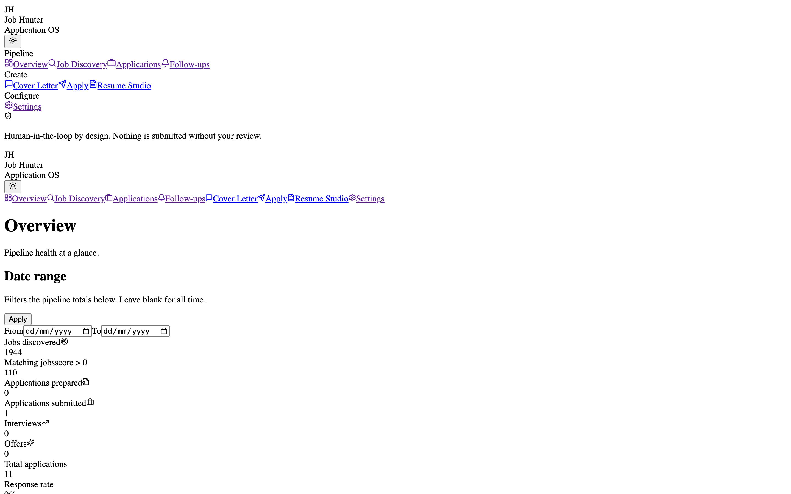
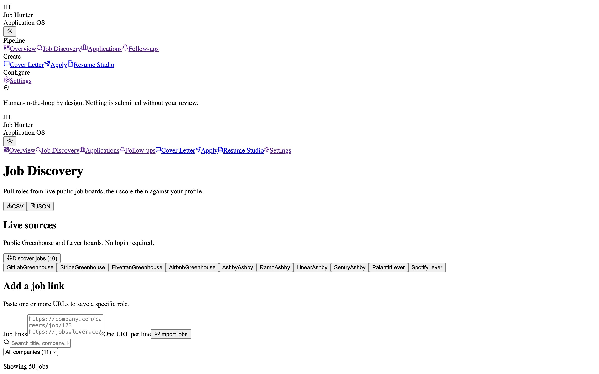
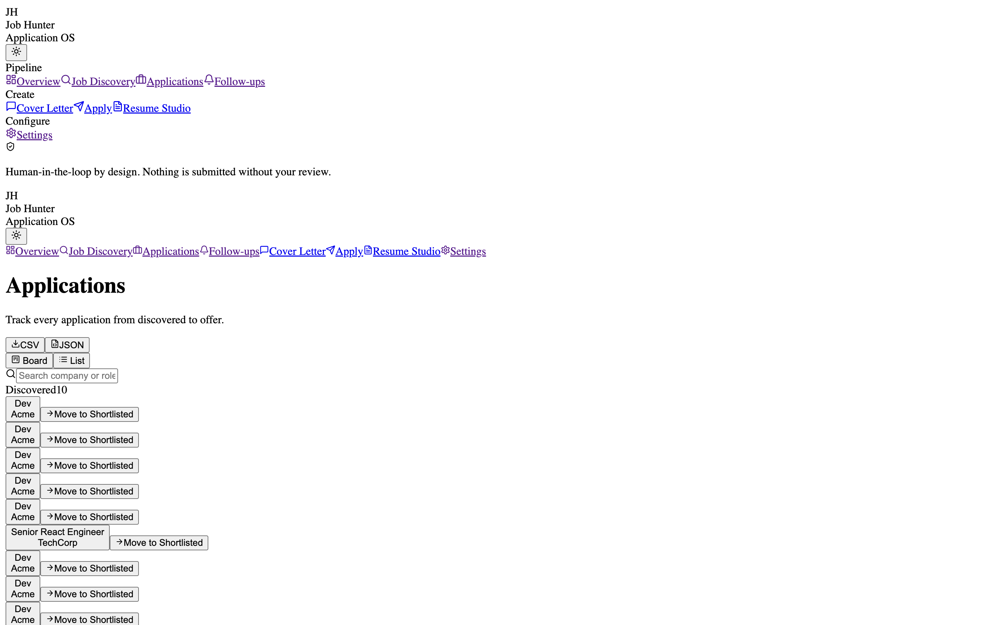
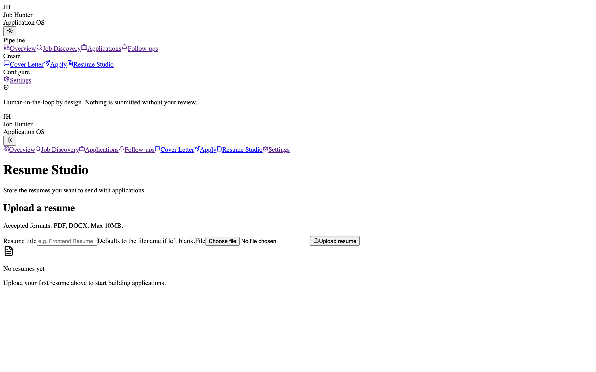

# Job Hunter OS

**A local-first job application tracker that runs on your machine, keeps your data on your
machine, and never submits an application without you approving it.**

[](https://github.com/sumitrao9/job-hunter-os/actions/workflows/build-windows.yml)
[](LICENSE)




## The problem

Job hunting produces a spreadsheet graveyard: 80 tabs, a Notion page, three different saved
searches, and no idea which application you followed up on. Hosted trackers want your résumé,
your history and your account before you can log a single application.

Job Hunter OS is the opposite: a local SQLite database you own, a FastAPI backend, and a React
UI that covers discovery → matching → resume tailoring → cover letter → application → follow-up
in one place.

| Jobs | Applications | Resume studio |
|---|---|---|
|  |  |  |

## What it does

- **Multi-source discovery** — pull listings from several job sources in one pass, normalise
  them into a single schema, and de-duplicate against what you have already seen.
- **Matching** — score listings against your profile and saved preferences; the matching
  service is unit-tested independently of the API.
- **Resume studio** — parse an existing résumé, keep multiple variants, and tailor per role.
- **Cover letters** — generate from the job + your profile, with the text editable before use.
- **Application pipeline** — kanban-style statuses, follow-up reminders, notes, exports.
- **Human-in-the-loop apply** — the apply workflow prepares everything and stops for approval.
  Nothing is submitted automatically.
- **Optional AI** — pluggable LLM service with a local Ollama path, so the app still works with
  no API key and no data leaving the machine.
- **Optional n8n automation** — for scheduled discovery on your own box.

## Architecture

```
┌──────────────────────────┐        ┌───────────────────────────────────────┐
│  React + Vite frontend   │  HTTP  │  FastAPI backend                      │
│  pages: dashboard, jobs, │ ─────► │  18 routers: jobs, applications,      │
│  applications, resumes,  │        │  discovery, matching, resumes,        │
│  profile, follow-ups…    │        │  cover_letter, auto_apply, export…    │
└──────────────────────────┘        └───────────────┬───────────────────────┘
                                                    │ services layer
                                    ┌───────────────▼───────────────────────┐
                                    │ matching · multi_discovery ·          │
                                    │ resume_parser · documents · llm/ollama│
                                    └───────────────┬───────────────────────┘
                                                    │ SQLAlchemy
                                    ┌───────────────▼───────────────────────┐
                                    │ SQLite (job_hunter.db, local only)    │
                                    └───────────────────────────────────────┘
```

## Quick start

### Docker (everything, including n8n)

```bash
docker compose up --build
```

- UI → http://localhost:5173
- API → http://localhost:8000
- n8n → http://localhost:5678 (optional)

### Backend only

```bash
cd backend
python -m venv .venv && source .venv/bin/activate
pip install -r requirements.txt
uvicorn app.main:app --reload --port 8000
```

### Frontend only

```bash
cd frontend
npm install
npm run dev
```

## Tests

```bash
cd backend && .venv/bin/python -m pytest -q
# 53 passed
```

Tests cover the API surface, matching logic and source adapters. The Windows desktop build is
built by CI (`.github/workflows/build-windows.yml`).

## Design notes

- **Local-first by default.** No accounts, no cloud sync, no telemetry. The database is a file
  you can copy, back up or delete.
- **Approval before action.** Auto-apply prepares an application and waits. This is a product
  decision, not a missing feature.
- **Permitted sources only.** Discovery talks to public listings and respects their terms; no
  scraping behind a login.

## Limitations

- Discovery adapters break when a source changes its markup — they are plain HTTP clients, not
  a managed scraper.
- Matching is lexical + heuristic (TF-IDF style) with optional LLM re-ranking, not a trained
  model.
- The desktop packaging story is Windows-first; macOS runs from source.

## License

MIT — see [LICENSE](LICENSE).
