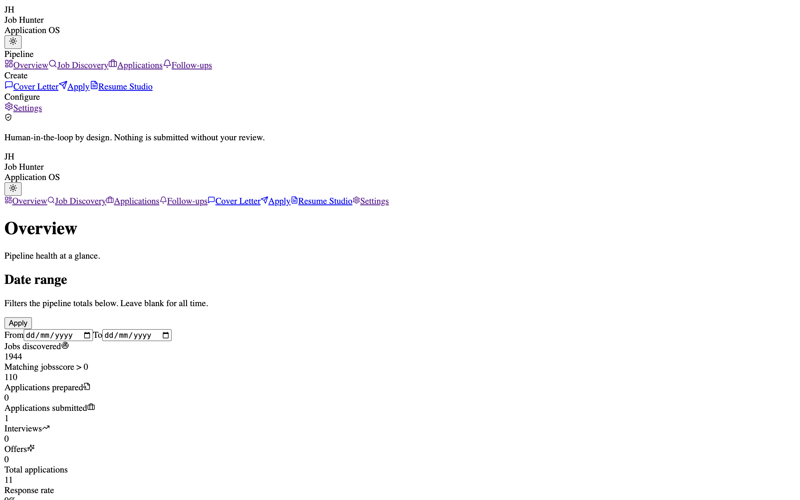
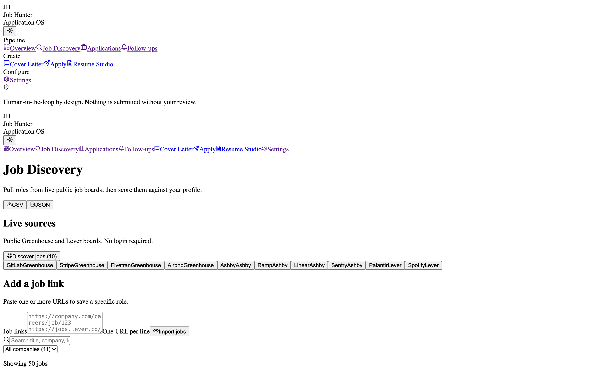
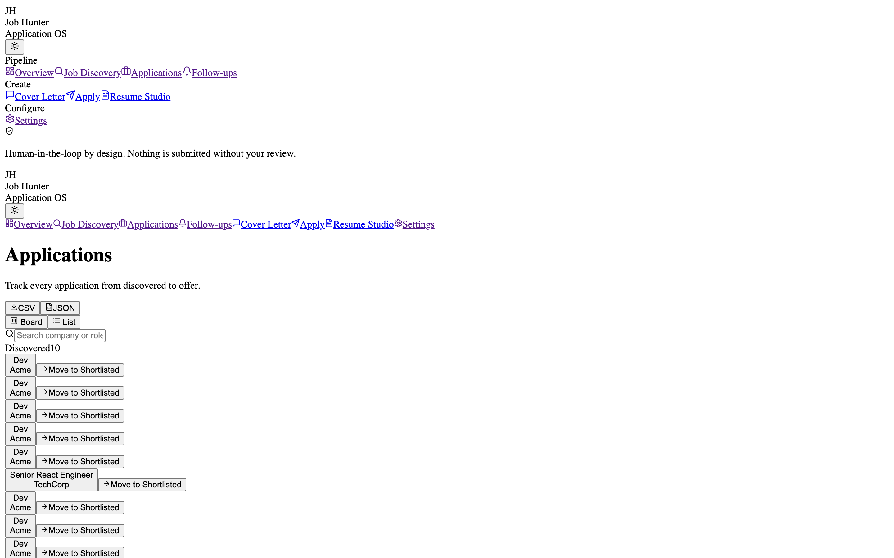
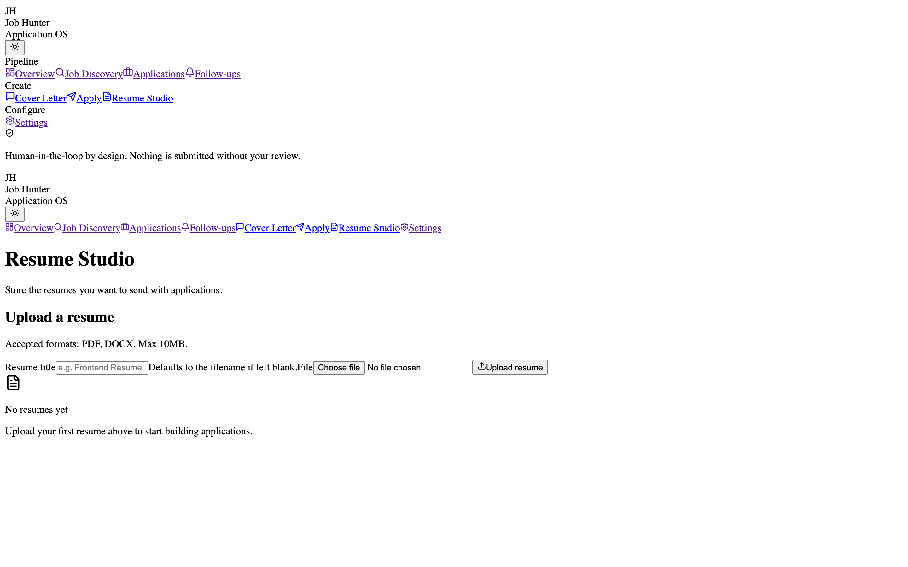

# Job Hunter OS

**Local-first job application tracker. Keep your data on your machine. Never apply without your approval.**

[](https://github.com/sumitrao9/job-hunter-os/actions/workflows/build-windows.yml)
[](LICENSE)


## Problem

Job hunting is chaos — 80 tabs, scattered spreadsheets, forgotten follow-ups. Most trackers lock your resume and history behind an account and push you to auto-apply.

## Solution

Job Hunter OS keeps everything local. A **FastAPI** backend + **React + Vite** frontend in one place to track the entire pipeline: discover → match → tailor → apply (with approval) → follow up.



## Features

| Feature | Description |
| --- | --- |
| **Multi-Source Discovery** | Pulls from multiple job boards, normalizes to a single schema, deduplicates automatically |
| **Smart Matching** | Scores listings against your profile and preferences. Matching logic unit-tested independently |
| **Resume Studio** | Parse resumes, maintain multiple tailored variants per role |
| **Cover Letter Generator** | AI-assisted cover letters editable before use |
| **Kanban Pipeline** | Track applications by status with notes, reminders, and follow-ups |
| **Human-in-the-Loop** | Prepares applications for review and approval. **Nothing is submitted automatically** |
| **Privacy-First AI** | Optional LLM support with local Ollama path — works with no API key, data stays local |
| **Export & Reports** | Export your application data anytime |
| **Docker Ready** | Full stack with `docker compose up` |

## Screenshots

| Jobs Board | Applications Pipeline | Resume Studio |
| --- | --- | --- |
|  |  |  |

## Quick Start

### Docker (Recommended)
```bash
docker compose up --build
```
- UI: [http://localhost:5173](http://localhost:5173)
- API: [http://localhost:8000](http://localhost:8000)
- API Docs: [http://localhost:8000/docs](http://localhost:8000/docs)

### Backend Only
```bash
cd backend
python -m venv .venv && source .venv/bin/activate
pip install -r requirements.txt
uvicorn app.main:app --reload --port 8000
```

### Frontend Only
```bash
cd frontend
npm install
npm run dev
```

## Tech Stack

**Backend:** FastAPI, SQLAlchemy, SQLite, Pydantic, Alembic  
**Frontend:** React 18, Vite, TypeScript, TanStack Query  
**AI/ML:** Optional LiteLLM/Ollama integration, scikit-learn for matching  
**Infra:** Docker, pytest, GitHub Actions

## Testing

```bash
cd backend && python -m pytest -q
# 53 tests passing
```

## Architecture

```
Frontend (React + Vite) → FastAPI Backend → Services Layer → SQLite
                        ↓
                    Matching • Discovery • Resume Parser • LLM/Ollama
```

## License

MIT License - see [LICENSE](LICENSE) for details.

## Support / Hosted / Hire
- **Hosted/Pro**: need a managed 24/7 endpoint, API keys, quotas, or integration help? Open an issue: https://github.com/sumitrao9/job-hunter-os/issues
- **Sponsor**: GitHub Sponsors (FUNDING.yml) supports maintenance.
- **Hire/Consulting**: custom features, deployment, or automation workflows (authorized use only).

*Built by [Sumit Yadav](https://github.com/sumitrao9). Authorized/ethical use only.*
